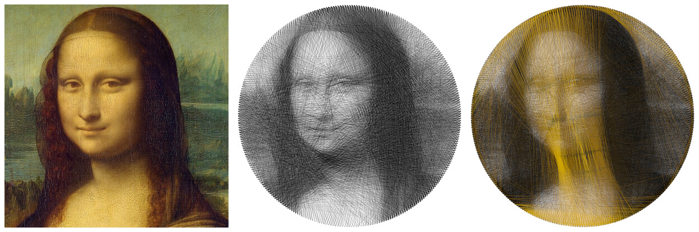

# String Art Studio

Turn a photograph into string art: one continuous thread wound between pins
on a frame. String Art Studio computes the winding sequence, shows how the
finished piece will look, and helps you wind the real thing.



*`examples/images/mona-lisa.jpg`: original, black thread (300 pins, 4000
segments), four colours suggested from the image (8000 segments).*

Desktop application (C++20, Qt 6 / QML) and command-line tool, running on
the CPU with all cores.


## Features

**Frame and image**
- Circle, ellipse, rectangle or custom pin positions from CSV, sized in
  millimetres.
- Place and resize the frame directly on the photo; rotate, crop, fit.
- Non-destructive tone adjustments: brightness, contrast, gamma, invert,
  histogram.

**Optimization**
- Greedy optimizer with an opacity-based thread model (overlapping threads
  darken gradually, as real thread does), anti-aliased lines and a weighted
  mean-squared-error objective. Optional extra weight on edges.
- Thread diameter in millimetres, so the result matches the physical frame.
- Multi-colour mode: each colour is one continuous thread, wound layer by
  layer. The layers are refined against each other until the error stops
  falling.
- Palette suggestion from the image (up to 8 colours), plus presets and a
  palette editor.
- Live preview, error map and side-by-side comparison; pause, resume,
  cancel. Keep up to 12 runs and compare them.

**Making the piece**
- Exports: PNG, SVG, CSV winding sequence (mm or px), JSON, project files.
- 1:1 pin template PDF, tiled on A4/A3/Letter with glue lines and
  registration marks, or on a single sheet.
- Printable winding guide PDF with thread lengths per colour.
- Playback of the sequence, and a full-window winding mode for the workshop:
  step with the keyboard or a foot pedal, optional spoken pin numbers, and
  the position is remembered.

**Convenience**
- Undo / redo of parameter changes, named presets, all settings restored on
  the next start.

## Build

Requirements: CMake ≥ 3.21, Ninja, a C++20 compiler and Qt ≥ 6.8 (Core, Gui,
Concurrent, Qml, Quick, QuickControls2, Widgets, Test). Qt TextToSpeech is
optional.

```bash
cmake -S . -B build -G Ninja -DCMAKE_BUILD_TYPE=Release
cmake --build build
./build/src/app/stringart-studio
```

Tested on Linux with GCC 16 and Qt 6.12.

## Command line

```bash
./build/src/cli/stringart-cli examples/images/mona-lisa.jpg --pins 300 --segments 4000 \
    --png out.png --csv out.csv
./build/src/cli/stringart-cli examples/images/mona-lisa.jpg --pins 300 --segments 8000 \
    --colors auto:4 --png colour.png
./build/src/cli/stringart-cli --help
```

Sample images to try are in [`examples/images`](examples/images/SOURCES.md).

## Tests

```bash
cd build && ctest --output-on-failure
```

## Background

I came across the 3Vial String Art project on Reddit and wanted to build my
own version as open source. String Art Studio is an independent
implementation: it shares no code, design or assets with 3Vial.

## Documentation

- [Building and running](docs/BUILDING.md): every option, the UI workflow,
  CLI examples.
- [Architecture and models](docs/ARCHITECTURE.md): modules, the thread and
  compositing model, the objective, the algorithms and their complexity.
- [Benchmarks](docs/BENCHMARKS.md): measured runtime, memory and error.
- [Manual tests](docs/MANUAL_TESTS.md): checks that need a person.
- [Specification](docs/SPECIFICATION.md): the original project brief.
